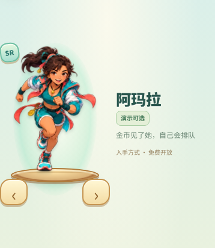
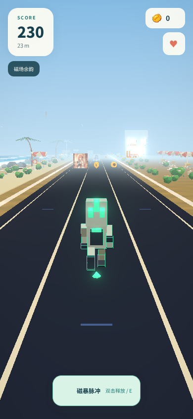

# 雷霆酷跑：全站体验、美术与工程优化框架

**审查日期：2026-11-11｜文档性质：方向性审查框架**

**后续执行入口**：[长任务工作流](site-optimization-workflow-2026-11-11.md) · [任务账本](site-optimization-tasks-2026-11-11.md) · [B01 验收记录](site-optimization/records/B01.md)。下文保留原审查基线与事实；当前已开始优化执行，首批五项在独立候选代码验收，尚未正式发布。

## 1. 文档目标与审查边界

本轮回答三个问题：**哪些方面值得优化、为什么值得关注、判断改善需要什么证据**。覆盖产品表达、视觉、交互、角色与场景美术、动作与音画、玩法代码、数据与服务、跨端和工程治理。

本文不展开代码改法、技术选型、界面改版稿、资产制作步骤、具体参数、工时或实施排期。

### 1.1 两套代码基线分开理解

| 标记 | 基线 | 本轮用途 |
| --- | --- | --- |
| **A：正式版** | `38d5116e03d92415584b4fa1b63381a6db104e4d`；源码树 `/tmp/opencode/thunder-run-integrate-collaborators-20261111` | 正式站的主要审查对象；Web、排行榜、任务后端的部署目录均指向此版本 |
| **B：微信在制版** | `/workspace/雷霆酷跑`；Git 基础 `ca6396a`，另有大量未提交改动 | 仅作为跨端能力、美术源工程及后续维护边界的补充观察，不归入正式站已发布能力 |

下文源码引用默认属于 **A**，涉及 B 的内容明确标注。远程 `origin/main` 本地缓存为 `a331f03`，本轮未联网重新确认，不将该缓存视为当前远程状态。

### 1.2 方法与证据等级

- **源码事实**：阅读关键入口、生产者与消费者、状态转换、持久化路径、配置及已有测试定义；属于跨模块结构审查，不声称逐行审计全部文件。
- **画面与交互观察**：使用 A 的已发布前端制品和同源代码启动隔离后端，临时数据库、全新本机档案；排行榜含六条明确命名为“审查样本”的合成记录，只用于排版观察。
- **专业判断**：解释已见画面对识别、层级、空间、情绪、操作预期的影响。判断与实现根因分开表达。
- **待验证问题**：真实设备帧时、长局稳定性、真实用户行为、读屏、声音听感及完整权利证明，均不由源码或静帧代替。

前序功能更新记录有 **808 项自动检查通过**；本轮未复跑完整测试，也不把该数量当作美术质量、目标端性能或完整安全验收。

### 1.3 保留当前已经确认的产品选择

- 当前十个角色暂时全部免费，是用户决定；本轮不以恢复解锁或收费为优化目标。
- 手机优先、轻快卡通、海滨大厅、原生文字与可滚动页面，是现有体验语境。写实、高模、更多装饰并非通用质量标准。
- 角色可因设计而高矮不同，不将“统一身高”当作角色美术目标。
- 草稿主题允许试玩，不自动等同于已完成美术验收；Web 可玩、离线图与 WX 打包通过也不等同于微信目标端完成。

## 2. 总体判断

工程已有明确的宿主边界、确定性模拟、服务端回放和局生命周期基础。当前值得关注的核心不只是“代码还能不能更快”，而是三种一致性：

1. **承诺与实际一致**：角色选角图、出战形象、功能入口和可用能力，是否表达同一个产品。
2. **行为与理解一致**：按钮外观、操作反馈、成绩单位、资产变化和结算结果，是否让玩家形成正确预期。
3. **表现与证据一致**：七种主题、动作、特效、跨端制品的可运行状态，是否有足够的画面、时序和目标设备证据支撑质量判断。

这三条主线同时关联美术完成度、交互可信度和工程可维护性，不能分别用“测试通过”或“画面有内容”替代。

**最值得优先讨论的已确认事实**：四个角色配置指向的模型缺失，阿玛拉的选角形象与局内回退形象明显不同；档案控件与主要页面存在风格落差；部分操作的视觉权重、键盘范围及数据口径与玩家预期不完全一致。七主题的情绪区分已经存在，但其空间叙事、危险预判和连续动作品质需要比“有场景、有动画”更深入的评价。

## 3. 现状图板与观察范围

以下为当前版本观察图，**不是改版设计稿**。图板链接可打开完整图片；图板只作缩略对照，关键判断还读取了对应原图。

### V1：页面视觉与信息层级

[查看当前页面视觉对照图板](review-evidence/2026-11-11/ui-plate.png)

排列顺序：大厅、角色页、设置；档案、商店、任务。主要视口为 390×844；另观察了 320×568 和 844×390 的大厅、选角布局。

### V2：十角色选角表现

[查看十角色选角表现对照图板](review-evidence/2026-11-11/roster-plate.png)

各格来自实际选角展示区。该图能比较造型、画法和展示权重，不能证明所有角色的局内模型和连续动作均已完成。

### V3：七主题跑局画面

[查看七主题跑局画面对照图板](review-evidence/2026-11-11/scene-plate.png)

顺序为白日海景、雨夜便利店、黄昏渔港、天穹雷脊；沉眠泰坦、熔炉巨兽、失重图书馆。每种主题采集了约 12m 与 100m 的画面，判断以图板和重点原图为依据；各局种子不同，不据同屏障碍数量比较主题难度。

### V4：跑动顺序帧

[查看牢大无操作跑动的顺序帧图板](review-evidence/2026-11-11/motion-plate.png)

样本使用正常浏览器时钟、未输入跳跃或技能；按 HUD 里程顺序抽取并裁出角色附近区域。采样不是等间隔视频，不据此给出 FPS 或完整动画循环验收。

### V5：同一角色的展示与实际出战

| 阿玛拉选角展示区 | 阿玛拉实际跑局 |
| --- | --- |
|  |  |

该对照由当前正式包产生：选角插画存在，配置指定的模型文件未进入正式包，运行时实际采用程序化回退形象。

### V6：补充页面样本

- [榜单首屏](review-evidence/2026-11-11/leaderboard.png)：隔离环境的合成排行数据，用于阅读层级和列表排版观察。
- [结算组件样本](review-evidence/2026-11-11/result-sample.png)：当前组件、固定回放成绩和等待校验状态；只观察页面表达，不将该图当成自然结算或真实上传结果。

## 4. 视觉、交互与艺术分析

### A1. 整体艺术定位与“同一个世界”的连续性

**已见事实**：大厅以沿海步道、暖色房屋、遮阳棚、棕榈和海水建立了鲜明的度假小镇气质；木金招牌、贝壳、补给与宝箱图标具有亲和力。白日跑局则以深色直路、简化几何、远景建筑和较浅的天海色为主要画面。二者的细节密度、材质和光照语言有明显距离。见 V1、V3。

**专业判断**：大厅已经是有吸引力的世界入口，主操作也清楚。跑局侧重通行、菜单允许停留，这种差异合理；艺术议题是玩家进入跑局后，是否仍能感到自己身处同一个海滨世界。现有问题不能简化为“低模不够好”或“需要更多装饰”。

**关注方向**：品牌核心意象、形状与材质语言、色彩气质、环境生活感，以及题材跨度与系列识别之间的关系。

**评价问题**：玩家不看标题时能认出这款游戏吗？“雷霆”的技能气质、海滨的亲和感与黑暗幻想主题之间，有哪些稳定的共同表达？世界的丰富性是否进入了玩家实际经历，而不只存在于宣传图和设定文字？

### A2. 角色身份承诺、资产完成度与阵容差异

**已见事实**：当前选角映射实际混合了四幅原图集角色插画、五幅 GLB 导出肖像和一幅单独生成的阿牛插画。插画侧更像运动海报，模型肖像侧更接近立体玩具展示，二者在描边、材质、光照和姿态张力上差异明显。见 V2、E11。

正式包中，十个角色有六个配置模型路径存在；阿玛拉、风剃、莉娜、时空行者的配置模型路径不存在。阿玛拉的实际跑局进一步确认了回退：棕色高马尾、青绿色衣装和红色飘带的选角形象，变成绿色方块式程序化人形。其他三名缺失角色的跑局未逐一观察，文件缺失不等于已观察了其全部表现。见 V5。

**专业判断**：这首先是“选中谁、实际玩到谁”的身份连续性问题，影响角色性格、收藏价值和选择的意义。回退保障了可运行性，是有效的工程保护；它不能单独证明角色艺术交付完成。六个路径存在也不代表六名角色均已通过动作、美术和权利验收。

**关注方向**：跨载体的轮廓、服饰标志、配色、物种与性格识别；角色展示权重；原型、回退和正式表现的完成度语义。

**评价问题**：小图、选角大图、背面跑局和技能状态是否仍是同一个角色？阵容的高矮胖瘦是现有优势，哪些差异是有意性格设计，哪些是裁切、留白或不同来源造成的展示失衡？全角色免费本身不是问题，但可选范围扩大后，这种表现差异会更容易被玩家体验到。

### A3. UI 视觉语法、文字与信息权重

**已见事实**：大厅、选角、设置、商店和任务普遍使用暖纸色、木金边框及雕刻式标题；档案则是深棕面板、白色矩形按钮和较紧密的头像排列，背包还直接显示 `shard_volt` 等内部式名称。局内 HUD 采用简洁浅色圆角卡片。见 V1。

**专业判断**：不同功能可以有不同语气；局内 HUD 简洁有利于认读，不应机械套用大厅装饰。当前需要明确的是：这些差异是否形成有帮助的层级，还是让部分页面像来自另一套原型。面板边界清楚，也不等于卡片内部的标题、说明、价格、条件、奖励和操作同样清楚。

榜单首屏同时承担规则解释、游客身份、个人纪录、列表状态和展开操作，首屏可见排行内容较少；商店的大图与装饰卡片较强，实际“购买”操作较弱。这是注意力分配与页面主任务的关系，不是装饰多少的单一问题。见 V1、V6。

**关注方向**：主次层级、字重与字号关系、留白节奏、文本密度、内部数据概念到玩家语言的转化，以及跨页控件的识别连续性。

**评价问题**：进入页面几秒内，玩家能否回答“这是什么、对我有什么用、现在能做什么”？说明规则与执行主任务是否争夺同一屏幕？角色、账号头像、匿名榜单身份之间的视觉与文字关系是否清楚？

### A4. 操作意图、状态语义与反馈可信度

当前核心体验链可以理解为：**找到角色 → 理解能力 → 开始 → 识别操作与危险 → 获得反馈 → 理解成绩及任务变化**。本轮从这些决策点分析交互，不以“按钮点击有响应”作为完整标准。

| 决策点 | 本轮事实 | 值得评价的品质 |
| --- | --- | --- |
| 开始与选角 | 大厅金色开始按钮、选角绿色开始按钮都显著；选中卡片和使用中主题有可见标记 | 主任务突出、当前状态清楚，这是应保留的长处 |
| 购买 | 390px 视口下，一个购买按钮的 CSS 边界约为 38×26.5px；零余额点击后文字反馈为“余额不足” | 重要操作的视觉权重、触控容错、拒绝原因在点击前后的可理解性；未测真人误触率 |
| 功能发现 | 大厅活动点击得到“还在准备中”；源码已有活动场景接线。仓库导航为占位，库存实际位于档案 | 可见入口、能力状态与产品意图是否一致；是否有意隐藏仍需确认 |
| 设置阅读 | 844px 高视口中的设置滚动内容约 1346px，音量位于主题列表之后 | 内容优先级、寻找成本、长页操作连续性；可滚动本身不是缺陷 |
| 档案键盘 | 从档案关闭按钮按一次 Shift+Tab，焦点实际进入背后的“音效音量”输入控件 | 模态声明与实际键盘范围是否一致；已修好的 Esc 冒泡问题不重复列入 |

“已拥有、当前使用、可以购买、暂不能执行、仅供展示”是不同语义。商店商品美术会产生获取期待，统一外形的卡片则未必能表达这些区别。全角色免费阶段，碎片商品与未来成长之间的用途也需要产品口径，而非默认恢复解锁收费。见 E12。

另有两处已确认的**信息可信度**问题：`thunderrun:best` 保存的是得分，档案却将其标为“米”；付费改名更新提示余额后，打开时构造的背包钻石行没有同步重绘。这些是源码明确的语义/状态关系，本轮未将其变成修复任务。见 E13。

**关注方向**：行为前的可预测性、反馈的可感知性与持续性、数据新鲜度、错误解释、焦点连续性和功能闭环。

**评价问题**：玩家是否知道是“调用成功”“成绩有效”“纪录更新”还是“任务有进度”？触屏提示与键盘提示混合时，新玩家能否理解实际操作？暂时保护、首次技能和结算规则是否按玩家需要的时间顺序被理解？

### A5. 场景空间、主题叙事与镜头构图

**已见事实**：七个主题已有明确的冷暖、昼夜与标志物差异。雷脊圆环装置、泰坦巨构、漂浮书本和红色印章，提供了超过单纯换色的题材信息；同时，深色三车道结构与多类通用物件仍有较强共性。见 V3。

**专业判断**：规则与基本赛道的熟悉性有助于操作；艺术深度还要看玩家记住的是“某种颜色”，还是“经过了一个怎样的地方”。场景描述中的世界观，需要由可见的空间尺度、层次、材质和经历来承载。暗色可以成立，关键是氛围与可读性能否同时成立。

| 主题 | 当前样本的辨识线索 | 重点分析维度 |
| --- | --- | --- |
| 白日海景 | 浅蓝天海、暖沙、棕榈和建筑；金币明显 | 与大厅海滨气质的亲缘性，远景层次和空间生活感 |
| 雨夜便利店 | 冷蓝夜色、亮窗、雨线 | 灯光焦点、暗部形体、天气与操作信息的关系 |
| 黄昏渔港 | 橙暖天空、仓储轮廓、灯柱与码头小件 | 黄昏光照与材质的统一感，工业空间的尺度与区域记忆 |
| 天穹雷脊 | 冷雨、金色导引和大圆环 | 装置的空间逻辑，“可穿越”与纯装饰是否容易区分 |
| 沉眠泰坦 | 暮色、骨/石巨构，近距离大形体遮挡较强 | 巨物压迫感、前中远景关系、接近过程的预判空间 |
| 熔炉巨兽 | 深棕火橙、热色线条、构件及粒子 | 暗部层次、题材材质识别和前景信息竞争 |
| 失重图书馆 | 书架、漂浮书页、巨型红印章 | 书页/环境书/机关书的角色区别，空间叙事与真实重力体验的关系 |

泰坦等样本中的大面积遮挡是已见画面事实，但它可能恰逢必须躲避的障碍接近或保护穿越，不能据单帧判定整个场景持续穿帮。应评价的是遮挡前的可预判性、遮挡期间的空间理解和通过后的恢复。600m 反重力等长局艺术表现尚未在本轮观察。

### A6. 危险、奖励与特效的信息编码

**已见事实**：高亮金色金币在不同主题中保持较稳定的识别，连续排列能自然引导路线；部分障碍表面是大幅人物图像，另一些主题使用场景化形体。雨线、细颗粒、漂浮书页、发光物、速度线和 HUD 状态同时参与画面。见 V3、V4。

**专业判断**：显眼与可理解不同。人物海报、装饰画、角色展示图和危险体可能竞争同一种视觉语义；不同主题皮肤下，同类障碍也可能需要重新学习。特效既承担氛围，又可能承担危险、奖励或技能提示，其注意力价值需要有可解释的层级。

**关注方向**：轮廓与危险边界的对应、同类对象跨主题识别、光色与状态的意义、天气/装饰/反馈之间的注意力竞争。

**评价问题**：玩家在接触前能否从外观判断“可跳、可钻、可站、须换道、可拾取”？最亮、最大或运动最快的元素，是否也是此刻最值得注意的信息？本轮暗色样本颗粒明显，但不据此推断真机 GPU 瓶颈或所有设备的观感。

### A7. 动作表达、接地感与镜头反馈

**已见事实**：无操作顺序样本中，牢大的双腿、手臂和身体姿态持续变化，并非完全静止；多帧可见其正面，脚部与画面下方投影/地面标记的距离较明显。另观察了跳跃、滑铲和技能输入后的帧，技能文字、速度线及姿态有变化。见 V4。

**专业判断**：黄紫配色与夸张肢体有利于追踪角色。当前值得深入分析的是：动作是否让人直觉地读出前进方向、支撑、腾空、落地和力度。现有样本产生接地感及朝向的视觉疑点；不能仅凭这些截图判定根骨、朝向参数或完整动画循环错误，卡通步态也无需套用写实标准。

**关注方向**：动作意图与输入的关系，姿态转换、身体/服饰/挂件的协调，投影与地面的参照，镜头反馈与玩家掌控感。

**评价问题**：玩家不看数值时，能否分辨跑、跳、铲、受击、保护与技能状态？状态切换是否保留动势和角色性格？镜头与闪白是帮助理解事件，还是分散预判？本轮抽样不支持顺滑度、帧率或所有角色的完整连续动作验收。

### A8. 成长回报、情绪节奏与声音艺术

**已见事实**：任务用进度条、奖励与领取状态表达长期目标；结算组件突出大得分、新纪录文案和再跑按钮，并同时出现首次金币前成绩。所见组件样本中的金色徽章未形成清楚的图形辨识。多数主题当前复用基础跑局音乐，雨夜另有音乐路径；本轮未实听。见 V1、V6、E14。

**专业判断**：进度正确、奖励到账和“让人感到这局有收获”是不同层面。视觉回报、情绪起伏、失败后的理解与再试意愿，需要与玩法事件结合评价；奖励仪式感也不能只靠装饰数量或声量。固定结算样本仅说明排版表达，不说明真实上传一直停留在等待状态。

**关注方向**：目标到达与回报的可感知性、主题音乐的情绪身份、动作/危险/奖励音色的角色、声画事件时序，以及声音密度与视觉密度的协调。

**评价问题**：关键事件能否在不增加阅读负担的情况下被察觉？音乐、角色声、危险提示与操作音是否互相支持？失败、破纪录和重新开始是否形成连贯的情绪节奏？曲风、混音、实际扬声器效果、触感延迟与真机舒适性仍属待验证项，本轮不给听感评分。

### A9. 美术生产质量与跨版本可持续性

**已知事实**：正式版的插画裁切、GLB 肖像、生成素材和运行时模型具有不同的派生路径；B 中存在可编辑源工程、动作重建和肖像流程，但尚未成为 A 的统一发布状态。部分历史素材的原始来源和再发布权利仍有待核实记录。见 B2、B3。

**关注方向**：资产的可编辑性、可重建性、来源与版本可追溯性、命名/应用位置的可理解性、跨端艺术验收以及权利证据覆盖。

**评价问题**：后来者能否找到对应的源、参数、产物和用途？当前使用、历史替换、离线展示与目标端实物是否容易区分？原始输入与模型、肖像等派生物的权利范围是否有相应证据？工具许可和仓库自述都不单独等于成品素材授权；本轮不据此作法律结论或决定替换路径。

## 5. 工程、业务与服务优化方向

### T1. 职责边界与变化传播范围

**现状**：依赖方向已明确为 app → game → framework；页面实现通过 renderer 注入。模拟总装同时协调移动、效果、主题机制、碰撞、收集、计分与事件；主题画面又跨越道路、角色、障碍、灯光和后处理。[E1][E2]

**关注方向**：职责可解释性、不变量归属、同一内容变化涉及哪些模块、平台与玩法之间的独立程度。已有的 300 行约束能控制文件长度，不能单独说明职责是否清晰。

**评价问题**：新增角色或主题时，哪些关系必须保持同步？维护者能否说明一个状态或资源的唯一归属？改动影响是否能在局部范围内被理解和验证？

### T2. 消费行为、存档与资产口径

**现状**：任务累计奖励与可消费余额已经分开，钱包余额和导入高水位共同落盘；但一次购买仍跨越扣款、限购、发货和装备等多次写入，改名也跨越档案与钻石余额保存。部分底层存储失败被静默吞掉，钱包层则会校验并抛错。[E3]

本机钱包不提供跨设备连续性或服务端权威余额保证，这是当前 MVP 边界；关注它与产品承诺是否相符，不将这一阶段选择直接定性为已发生的安全事故。

**关注方向**：完整业务操作的结果一致性、失败可解释性、两种视图中的消费规则归属。不能把一次钱包写入的保障外推为整个购买或改名已具备整体成功语义。

**评价问题**：部分保存失败时，玩家看到的成功、次数变化、扣款和到账是否相符？本机资产、任务累计账本、匿名身份各自意味着什么？真实存储受限环境的出现频率尚未测量。

### T3. 对局可复现性与版本语义

**现状**：模拟使用固定步长和 `RunRng`；两类在线票据绑定角色与主题，任务票据另保存装备清单，当前排位局不消费装备。另一方面，离线 v1 重放工具只保留种子、角色、输入等字段，执行时使用默认主题、默认装备；排行榜规则标识包含完整配置，但未直接标识模拟代码版本。任务票据可跨重启保存，结算仍使用当前模拟器与配置。[E2][E4]

**关注方向**：不同入口所描述的“同一局”是否相同、规则标识的含义、内容版本与模拟版本的边界、旧局结算兼容性。

**评价问题**：哪些变化应影响对局资格，哪些只属于展示与运营？旧票据遇到改变模拟结果的升级时，玩家应得到什么结果？规则标识不等同于身份或防作弊凭据。

### T4. 配置契约与内容可验证性

**现状**：八份配置具备信封、ID、引用与效果原语检查；商店和解锁等消费数据已有专门校验。类型层仍有较宽泛的条目/参数对象，主题光照、画面 grade、潮汐、穿越、反重力等约束并未在所有契约层完整表达，部分消费点自行解析或降级。[E5]

**关注方向**：类型、编辑器 schema、构建校验、运行时解释之间的一致性，以及误配被发现的时机。

**评价问题**：合法配置应满足哪些数值和跨字段关系？默认值和回退代表正常兼容还是内容错误？内容作者能否在发布前理解错误，而非仅看到运行时表现与预期不同？

### T5. 实时运行与资源生命周期

**现状**：角色、赛道、特效和渲染器有显式创建/销毁入口，输入、尺寸及可见性订阅有退订路径；资源释放分布于总装、各子模块与 Web 壳。Web 包含游戏与 UI 画布，以及有条件启用的多 pass 后处理。[E6]

启动阶段并行预取配置和注入多类资源，角色/道具模型、字体与音视频又具有不同的就绪和回退语义。构建制品的体积统计不能直接说明首次可交互、首次可玩或实际等待的来源。[E15]

**关注方向**：首屏到首局的体验连续性、资源就绪与回退的表达、画面表现成本与可读性的平衡、跨局资源稳定性、平台降级的可解释性。

**评价问题**：能看到大厅、能点击开始、模型/视频已就绪是否被混作同一个阶段？重复进出局、切换角色/主题后，CPU/GPU 资源趋势是否稳定？不同分辨率与 DPR 下画面成本如何变化？当前没有依据判定具体 GPU 瓶颈或已发生内存泄漏。

### T6. 结算可恢复性与结果解释

**现状**：排行榜在进入回放前消耗票据，后续队列繁忙、超时或 worker 失败可能返回 503。客户端将多类错误收敛为上传失败；任务接口调用成功、回放有效、获得进度和领取奖励又是不同状态。[E7]

**关注方向**：临时失败对已完成对局的影响范围、结果确定性、用户解释与恢复预期。

**评价问题**：玩家怎样知道失败来自规则、网络还是服务状态？一次有效对局在故障下能得到怎样的结果保证？当前明确存在状态路径，但没有本轮生产损失率或故障频率数据。

### T7. 身份、长期数据与容量边界

**现状**：榜单、任务和本机档案使用不同身份与存储。任务对局有保留期，符合条件的空游客会清理；保留用户的历史周期仍有增长空间。排行榜有界 worker/队列，任务回放则在 HTTP 进程分段让出；两类服务均有容量和限流边界。[E8]

**关注方向**：数据归属、权益保留、长期增长成本、正常玩家在饱和状态下的公平可用性。

**评价问题**：清 cookie、清站点存储、换浏览器和重启服务分别影响什么？哪些历史信息有保留价值？查询、回放、排队和备份恢复随规模如何变化？回放符合规则也不等于操作来自真人。

### T8. 验证、可观测性与发布可追溯性

**现状**：已有模拟/界面/接口回归、15 例 golden 及跨系统 CI；浏览器冒烟脚本存在，但 CI 配置未调用它。golden 使用五个种子、三个角色和默认主题；健康检查主要确认数据库可访问。正式版、未推送的本地集成版本和微信在制树并存。[E9][E10]

**关注方向**：验证层级与实际体验的对应关系、故障归因能力、交付与协作记录是否一致。

**评价问题**：哪些证据覆盖逻辑，哪些覆盖连续画面、真实触控、网络和目标端？维护者能否从线上版本找到对应源码、资源、配置与验收记录？异常是否能区分内容/模拟错误和普通成绩拒绝？本轮不据源码推断现网监控是否完备。

## 6. 跨端与美术生产的补充边界

- **A 的 WX 入口仍是空场景/配置验证壳**；B 才包含完整游戏主流程、共享 renderer、云身份/任务/商店等在制接线。两者不能合并写成“正式站已完成微信游戏”。[B1]
- B 已有可编辑角色源工程、代码化建模/动作与肖像重建流程，但这些能力没有自动证明 A 的运行时资产均可编辑、可复建，或 B 已合入发布。[B2]
- 当前 Web 原生 Noto 字体与历史 SDF atlas 的来源证据不同；历史模型、音频及派生素材的权利记录也存在待核实边界。仓库自述、工具许可和成品素材授权分别理解。[B2][B3]
- 框架关注的是跨端能力状态、艺术生产的可追溯性与验收证据，不在本轮决定引擎、迁移路径或资产替换方式。

## 7. 下一轮讨论的共同语言

### 7.1 分析优先级

这里排序的是**哪些问题应先被理解和讨论**，不是整改排期，也没有预设具体改法。

| 分组 | 主要议题 | 排序依据 |
| --- | --- | --- |
| 优先讨论：有明确事实或触发路径 | 角色宣传与出战身份连续性；档案指标/资产显示口径；购买等行为的完整结果；模态键盘范围 | 有源码或实际交互证据，直接关联“我选了谁、看懂什么、操作是否可信”；不据此声称已发生生产资产损失 |
| 优先澄清：跨系统保证与产品语义 | 旧局遇到升级时的结算语义；临时故障后的成绩结果；本机档案/任务/榜单的数据归属；功能入口与阶段状态 | 结构和边界已知，产品保证、触发范围或真实影响尚需界定 |
| 重点采证：表现深度与运行品质 | 场景空间与危险预判；动作接地和朝向观感；真实触控；首局等待；帧时/热稳定性；长期数据增长 | 不能用单帧、文件体积、健康响应或测试数量决定结论 |
| 随产品演进持续审视 | 多主题系列识别；回报情绪和声音；素材可编辑/可重建与权利证据；在制艺术成果与正式发布的对应 | 影响长期品质，但应与当前免费试玩和跨端阶段选择相协调 |

几个议题存在明确联动：**角色资产完成度 ↔ 展示承诺**，**消费结果一致性 ↔ 交互信任**，**规则版本 ↔ 结算恢复**，**视觉密度 ↔ 危险可读性 ↔ 设备表现**。它们比孤立地追求更多细节或更短代码更值得共同评价。

### 7.2 议题表达结构

原审查阶段用以下结构表达议题；后续已在[工作流设计](site-optimization-workflow-2026-11-11.md)中进一步定义任务与追踪方式，实际实施状态以任务账本为准：

| 字段 | 应说明的问题 |
| --- | --- |
| 体验对象 | 哪类玩家、哪个页面或哪段跑局体验受到影响 |
| 已知事实 | 可定位的源码、画面、交互轨迹或制品事实 |
| 价值判断 | 对理解、识别、表现力、可信度或维护成本的影响 |
| 不确定性 | 根因、发生范围、目标设备差异和产品意图中哪些尚不明确 |
| 期望品质 | 希望哪种体验或工程性质更稳定，而非预先指定改法 |
| 判断证据 | 哪类观察能够区分真正改善与只是换一种表现 |

不以代码行数、几何数量、特效数量、测试总数或“更像某种热门画风”单独评判质量。

## 8. 源码证据索引

路径均相对 1.1 节对应基线；行号用于本次版本定位。

| 编号 | 证据入口 |
| --- | --- |
| E1 | `docs/architecture.md:3–46`；`apps/web/src/bootstrap.ts:26–54`；`packages/game/src/ui/overlayViews.ts:65–80` |
| E2 | `packages/game/src/core/sim/runnerSim.ts:84–123,205–255`；`packages/game/src/core/rng.ts:29–61`；`packages/game/src/core/sim/themeRules.ts:3–18` |
| E3 | `packages/game/src/flow/localEconomy.ts:115–144`；`packages/game/src/flow/missionRewardWallet.ts:17–73`；`apps/web/src/profileOverlay.ts:79–96`；`apps/web/src/platform/webPlatform.ts:105–109` |
| E4 | `packages/game/src/core/leaderboard.ts:27–36`；`tools/replay/runner.mjs:94–124,147–165`；`server/index.mjs:144–153,182–188`；`apps/server/src/store.mjs:33–45`；`apps/server/src/replay.mjs:16` |
| E5 | `packages/game/src/core/config/configTypes.ts:11–42`；`packages/game/src/core/config/configValidator.ts:23–73,145–217`；`packages/game/src/core/sim/zones.ts:23–29`；`schema/config.schema.json` |
| E6 | `packages/game/src/render/runnerScene.ts:77–117,125–144,276–294`；`packages/game/src/render/postfx.ts:133–169,195–202`；`apps/web/src/uiShell.ts:131–144,195–207` |
| E7 | `server/index.mjs:169–206`；`packages/game/src/flow/runSession.ts:64–68`；`apps/web/src/leaderboardClient.ts:10–17`；`apps/server/src/mission-service.mjs:232–288` |
| E8 | `server/replay-pool.mjs:12–35,123–135`；`server/pageSessions.mjs:18–44`；`server/store.mjs:24–60`；`apps/server/src/store.mjs:73–80,134–142`；`apps/server/src/replay.mjs:19–30` |
| E9 | `.github/workflows/ci.yml:10–66`；`tools/e2e-smoke.mjs:1–7,49–82`；`tools/replay/golden-gen.mjs:18–31`；`server/index.mjs:102–108`；`server/replay-worker.mjs:35–41` |
| E10 | 本轮 Git 状态/部署 symlink 核对；`docs/collaborator-integration-2026-11-11.md` 与 `docs/pending-ui-updates-2026-11-11.md` 作为前序记录，不代替当前源码 |
| E11 | `config/characters.json:7–169`；`apps/web/src/selectCharacterArt.ts:13–31`；`apps/web/src/assets/character-select/portraits/README.md:5–10`；`packages/game/src/render/avatarRig.ts:81–113`；本轮正式包路径盘点与 V5 |
| E12 | `apps/web/src/mobileLobby.ts:59–66,87–90`；`apps/web/src/shopOverlay.ts:36–48`；`apps/web/src/mobileUi.ts:28–41`；`apps/web/src/mobilePanels.ts:15–24`；本轮隔离浏览器交互记录 |
| E13 | `packages/game/src/flow/mainFlow.ts:240–248`；`apps/web/src/profileOverlay.ts:15–19,49,79–113`；`apps/web/src/missionPanel.ts:83–115` |
| E14 | `apps/web/src/mobilePanels.ts` 的 `createMobileResult`；`config/themes.json` 的各主题 `music` 字段；`packages/game/src/core/audio/audioDirector.ts`；V6 固定回放组件样本 |
| E15 | `apps/web/src/bootstrap.ts:26–38,83–93`；`apps/web/src/startupConfig.ts:3–19`；`apps/web/src/introVideo.ts:11–19,21–53,60–79`；`packages/game/src/render/pickupModels.ts:47–73` |
| B1 | A：`apps/wx/src/main.ts:1–13`；B：`apps/wx/src/bootstrap.ts:12–48`、`apps/wx/src/platform/runtime.ts:16–50` |
| B2 | B：`tools/art/README.md:3–4,22–67`；`art-source/coastal/README.md:3–7,19–26`；`assets/fonts/noto/README.md` |
| B3 | A：`apps/web/src/assets/mobile-ui/README.md:3–11`；`assets/fonts/README.md:23–27`；`assets/audio/README.md`；B：`docs/goals/wechat-release-2026-11-06/launch/OWNER-INPUTS.md:16–19` |

## 附录 A：只读规模快照

| A 基线目录 | TS 文件数 | 文本行数（含注释、空行） |
| --- | ---: | ---: |
| `apps/web/src` | 33 | 2,879 |
| `apps/wx/src` | 13 | 864 |
| `packages/framework/src` | 37 | 3,844 |
| `packages/game/src/core` | 36 | 3,669 |
| `packages/game/src/flow` | 16 | 1,574 |
| `packages/game/src/render` | 91 | 13,889 |
| `packages/game/src/ui` | 20 | 2,223 |
| **以上七个目录合计** | **246** | **28,942** |

另有排行榜 7 个、任务服务 9 个 `.mjs` 文件和 101 个 Node 测试文件。上述七个目录中有 13 个 TS 文件达到 280 行以上；这只是维护关注面，不直接决定重构需求。

当前 Web 构建快照为 **165 个文件、约 26.96 MB**，其中 PNG 约 10.02 MB、GLB 约 4.94 MB、视频约 3.17 MB、MP3 约 2.78 MB；主入口 JS 原始大小约 1.14 MB。它们是制品统计，**不是首屏下载量、压缩后传输量或运行时显存占用**。

## 附录 B：观察局限与操作记录

- 本轮浏览器为云端 Chromium、软件 WebGL 和手机视口仿真；使用既有授权的降级隔离模式。画面关系可观察，真机色彩、帧率、触感、温升和持续运行表现尚未验证。
- 已保留页面、十角色选角、七主题早段画面及跑动/输入后帧样本。未覆盖 600m 反重力、完整长局与所有角色的全部连续动作；音频未实听。
- 一次完整页面观察在等待自然结算的 120 秒窗口内未取得结算画面；未将它判定为游戏不能结束。结算页面另用当前组件与固定回放样本观察，含首次金币前记录和等待校验状态，只用于表达/排版分析。
- 图板是原始截图的排版、缩放或局部裁切，未改变角色、配色或场景内容。Pillow 不可用，改用已有的自包含 HTML 观察路线完成图板。
- 观察服务和临时后端已关闭；正式站仍为 A。原图与本轮统计保留于 `/tmp/opencode/thunder-run-review-framework-20261111/`。
